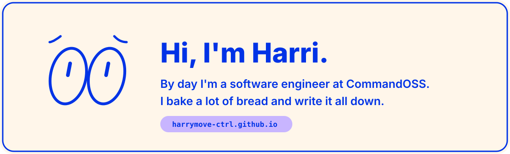

  <a href="https://harrymove-ctrl.github.io/">
    <picture>
      <source media="(prefers-color-scheme: dark)" srcset="./assets/harri-banner-dark.svg" />
      <source media="(prefers-color-scheme: light)" srcset="./assets/harri-banner-light.svg" />
      
    </picture>
  </a>

  <a href="https://harrymove-ctrl.github.io/"><strong>Live Website: harrymove-ctrl.github.io ↗</strong></a>

## Hi, I'm Harri

I build AI tools, native Rust desktop apps, and local-first developer infrastructure. By day I'm a software engineer at [CommandOSS](https://github.com/CommandOSSLabs). I bake a lot of bread and write it all down on [harrymove-ctrl.github.io](https://harrymove-ctrl.github.io/).

## Some Things I Made

| Project | What It Does | Repository |
| :--- | :--- | :--- |
| **AGY Profiles** | Clean-room multi-profile sandbox manager, stdio MCP server, and local console for Antigravity | [harrymove-ctrl/agy-profiles](https://github.com/harrymove-ctrl/agy-profiles) |
| **AI DevKit** | Documentation and engineering workflow kit supporting coding agents at CommandOSS | [CommandOSSLabs/ai-devkit](https://github.com/CommandOSSLabs/ai-devkit) |
| **AGY Tele** | Two-way Telegram and Antigravity Desktop sync daemon built on SQLite FTS5 | [harrymove-ctrl/agy-tele](https://github.com/harrymove-ctrl/agy-tele) |
| **Discord Radar** | Local Discord channel archiver, SQLite FTS5 search CLI, and topic signal extractor | [harrymove-ctrl/discord-radar](https://github.com/harrymove-ctrl/discord-radar) |
| **MacroGate** | Multimodal FX and Gold volatility-regime and pre-trade risk-veto copilot on TimeF | [harrymove-ctrl/macrogate](https://github.com/harrymove-ctrl/macrogate) |
| **WhatNext** | Memory-grounded prompt prediction, live draft autocomplete, and workflow learning for agents | [harrymove-ctrl/whatnext](https://github.com/harrymove-ctrl/whatnext) |
| **Sui CLI Web** | Keyboard-first web interface for the Sui CLI built at CommandOSS | [harrymove-ctrl/sui-cli-web](https://github.com/harrymove-ctrl/sui-cli-web) |

## Say Hi

1. Website: [harrymove-ctrl.github.io](https://harrymove-ctrl.github.io/)
2. Organization: [CommandOSSLabs](https://github.com/CommandOSSLabs)
3. Email: [harry.phan@commandoss.com](mailto:harry.phan@commandoss.com)
